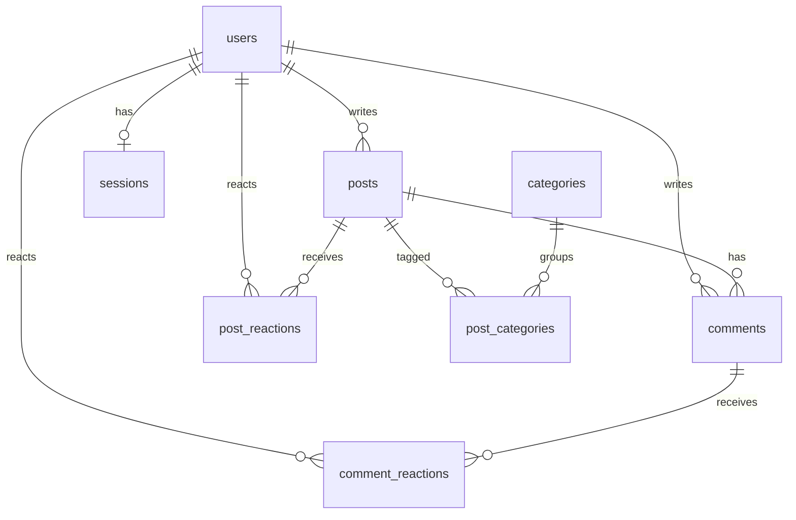

# 💬 Forum — Zone01 Athens

A web forum written in **Go** with a **SQLite** database, packaged with **Docker**.
Users can register, log in, create posts in categories, comment, and like/dislike
posts and comments. No frontend frameworks or JavaScript are used.

---

## Table of Contents

- [Features](#features)
- [Tech Stack](#tech-stack)
- [Quick Start (Docker)](#quick-start-docker)
- [Run Locally (without Docker)](#run-locally-without-docker)
- [Running Tests](#running-tests)
- [Project Structure](#project-structure)
- [Routes](#routes)
- [Database](#database)
- [Inspecting the Database](#inspecting-the-database)
- [Error Handling](#error-handling)
- [Authors](#authors)

---

## Features

**Authentication**
- Registration with username, email and password
- Duplicate username/email detection (`409 Conflict`)
- Login with username **or** email
- Sessions stored in SQLite with a UUID v4 token in an `HttpOnly` cookie
- Sessions expire after 24 hours
- One active session per user — logging in from another browser ends the previous session
- Logout deletes the session and clears the cookie

**Posts & Comments**
- Registered users can create posts and assign one or more categories
- Registered users can comment on posts
- Empty posts or comments are rejected (`400 Bad Request`)
- Guests can view all posts and comments, but cannot create them

**Likes & Dislikes**
- Registered users can like or dislike posts and comments
- A user can't like and dislike the same item at the same time
  - clicking the same reaction again removes it
  - clicking the opposite reaction switches it
- Like/dislike counts are visible to everyone

**Filtering**
- By category
- **My Posts** — posts created by the logged-in user
- **Liked Posts** — posts liked by the logged-in user

---

## Tech Stack

| Component | Technology |
| --- | --- |
| Language | Go 1.26+ |
| Database | SQLite 3 |
| HTTP | Go standard library `net/http` |
| Templates | Go `html/template` |
| Container | Docker (multi-stage build, Alpine) |

**Packages used**

- Go standard library
- [`github.com/mattn/go-sqlite3`](https://github.com/mattn/go-sqlite3) — SQLite driver
- [`github.com/google/uuid`](https://github.com/google/uuid) — session tokens

---

## Quick Start (Docker)

The easiest way to run the project is with the helper script:

```bash
./docker.sh
```

This builds the image and starts the container. Then open **<http://localhost:8080>**.

### `docker.sh` commands

| Command | Description |
| --- | --- |
| `./docker.sh` or `./docker.sh start` | Build the image and run the container |
| `./docker.sh build` | Build the image only |
| `./docker.sh run` | Run the container without rebuilding |
| `./docker.sh stop` | Stop and remove the container |
| `./docker.sh restart` | Restart the container |
| `./docker.sh logs` | Follow the container logs |
| `./docker.sh clean` | Remove the container and the image |
| `./docker.sh help` | Show the help menu |

> If you get `Permission denied`, make the script executable first: `chmod +x docker.sh`

### Manual Docker commands

```bash
# Build the image
docker image build -t forum .

# List images
docker images

# Run the container
docker container run --name forum-container -p 8080:8080 forum

# List containers
docker ps -a

# Stop and remove the container
docker stop forum-container
docker rm forum-container

# Remove the image
docker rmi forum
```

> **Note:** The database lives inside the container. Removing the container
> deletes its data.

---

## Run Locally (without Docker)

### Prerequisites

- Go 1.26 or newer
- A C compiler (`gcc`) — required by `go-sqlite3` (CGO)

On Ubuntu / Debian:

```bash
sudo apt update
sudo apt install build-essential
```

### Start the server

From the project root:

```bash
CGO_ENABLED=1 go run ./cmd
```

Expected output:

```text
Starting database...
Database connected successfully
Running migrations...
Migrations ran successfully
Server is running on http://localhost:8080
Press Ctrl + C to terminate the server...
```

Open **<http://localhost:8080>**.

---

## Running Tests

```bash
CGO_ENABLED=1 go test ./...
```

The tests use temporary SQLite databases (not the real `forum.db`) and cover:

- database migrations
- route registration
- registration, login, sessions and logout
- posts, comments and categories
- likes/dislikes
- post filters

---

## Project Structure

```text
forum/
├── cmd/
│   └── main.go                 # Entry point: opens DB, runs migrations, starts server
├── internal/
│   ├── db/
│   │   ├── create_DB.go        # Opens the SQLite connection
│   │   ├── create_DB_Tables.go # Runs the SQL migration files
│   │   └── migrations/         # CREATE TABLE scripts (001 – 008)
│   ├── handlers/               # HTTP handlers (auth, posts, comments, reactions, errors)
│   └── server/
│       └── server.go           # Route registration and HTTP server
├── templates/                  # HTML templates and CSS
├── Dockerfile                  # Multi-stage Docker build
├── docker.sh                   # Helper script to build and run with Docker
├── go.mod
└── go.sum
```

---

## Routes

| Route | Method | Access | Description |
| --- | --- | --- | --- |
| `/` | GET | Everyone | Home page with all posts and filters |
| `/?category=<id>` | GET | Everyone | Posts of one category |
| `/?filter=created` | GET | Logged in | My posts |
| `/?filter=liked` | GET | Logged in | My liked posts |
| `/register` | GET, POST | Everyone | Registration form / create account |
| `/login` | GET, POST | Everyone | Login form / start session |
| `/logout` | POST | Logged in | End session |
| `/create_post` | GET, POST | Logged in | Post form / create post |
| `/post?id=<id>` | GET | Everyone | View a post and its comments |
| `/post?id=<id>` | POST | Logged in | Add a comment |
| `/post/react` | POST | Logged in | Like / dislike a post |
| `/comment/react` | POST | Logged in | Like / dislike a comment |

---

## Database

The database file is created automatically at `internal/db/forum.db` on first run.
Tables are created from the files in `internal/db/migrations/` using
`CREATE TABLE IF NOT EXISTS`, so restarting the server is safe.



| Table | Purpose |
| --- | --- |
| `users` | Accounts (unique username and email) |
| `posts` | Forum posts |
| `comments` | Comments on posts |
| `categories` | Default: General, Tech, Funny, Games, News |
| `post_categories` | Many-to-many link between posts and categories |
| `post_reactions` | One like/dislike per user per post |
| `comment_reactions` | One like/dislike per user per comment |
| `sessions` | Login sessions (one per user, with expiry) |

---

## Inspecting the Database

```bash
sqlite3 internal/db/forum.db
```

Useful commands inside the SQLite prompt:

```sql
.tables
.headers on
.mode column
SELECT * FROM users;
SELECT * FROM posts;
SELECT * FROM comments;
.quit
```

When running in Docker, open the database inside the container:

```bash
docker exec -it forum-container sh
# the image has no sqlite3 by default; install it if needed:
apk add sqlite
sqlite3 internal/db/forum.db
```

---

## Error Handling

All errors are shown on a custom error page. Technical details are logged to the
terminal, never sent to the browser.

| Status | When |
| --- | --- |
| `400 Bad Request` | Empty or invalid form data, invalid category |
| `401 Unauthorized` | Guest tries to comment/react, or wrong login credentials |
| `404 Not Found` | Unknown page, post, comment or category |
| `405 Method Not Allowed` | Wrong HTTP method for a route |
| `409 Conflict` | Username or email already registered |
| `500 Internal Server Error` | Unexpected server or database error |

---

## Authors

- **gelafros**
- **ktallaris**
- **ebimai**
- **pmetaxas**
- **pkallige**

Zone01 Athens

## License

MIT, see [LICENSE](LICENSE).
