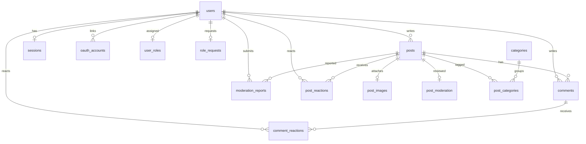

# 💬 Forum — Zone01 Athens

A web forum written in **Go** with a **SQLite** database, packaged with **Docker**.
Users can register, log in, create posts in categories, comment, and like/dislike
posts and comments. No frontend frameworks or JavaScript are used.

---

## Table of Contents

- [Features](#features)
- [Tech Stack](#tech-stack)
- [Quick Start (Docker)](#quick-start-docker)
- [Run Locally (without Docker)](#run-locally-without-docker)
- [OAuth Setup (Google \& GitHub)](#oauth-setup-google--github)
- [Running Tests](#running-tests)
- [Project Structure](#project-structure)
- [Routes](#routes)
- [Database](#database)
- [Inspecting the Database](#inspecting-the-database)
- [Error Handling](#error-handling)
- [Configuration](#configuration)
- [Authors](#authors)
- [License](#license)

---

## Features

**Authentication**
- Registration with username, email and password (bcrypt-hashed)
- Social login & registration via **Google OAuth 2.0** and **GitHub OAuth 2.0** (with CSRF `state` verification and automatic account linking)
- Duplicate username/email detection (`409 Conflict`)
- Login with username **or** email
- Sessions stored in SQLite with a UUID v4 token in an `HttpOnly` cookie
- Sessions expire after 24 hours
- One active session per user — logging in from another browser ends the previous session
- Logout deletes the session and clears the cookie

**Posts & Comments**
- Registered users can create posts, assign one or more categories, and attach an **image** (**JPEG, PNG, GIF, or SVG**, up to **20 MB**)
- Images are validated by both magic bytes and extension, stored with UUID filenames, and displayed to both registered users and guests
- Registered users can comment on posts
- Empty posts or comments are rejected (`400 Bad Request`)
- Guests can view all posts and comments, but cannot create them

**Likes & Dislikes**
- Registered users can like or dislike posts and comments
- A user can't like and dislike the same item at the same time
  - clicking the same reaction again removes it
  - clicking the opposite reaction switches it
- Like/dislike counts are visible to everyone

**Filtering**
- By category
- **My Posts** — posts created by the logged-in user
- **Liked Posts** — posts liked by the logged-in user

**Moderation & 4-Tier Role System (`forum-moderation`)**
- **Guests**: View approved posts, comments, and like/dislike counts
- **Users**: Create posts, comment, react, and request promotion to Moderator
- **Moderators**: Approve pending posts, delete violating posts, and submit categorized reports (`irrelevant`, `obscene`, `illegal`, `insulting`) to Administrators
- **Administrators**: Promote/demote users (`user` ↔ `moderator`), review and respond to moderator reports, delete any post or comment, and create/delete categories

**Security & HTTPS (`forum-security`)**
- **HTTPS / TLS 1.2+**: Automatic self-signed ECDSA P-256 certificate generation (`certs/cert.pem`, `certs/key.pem`) and explicit ECDHE AEAD cipher suites (`AES-GCM` & `ChaCha20-Poly1305`)
- **Rate Limiting**: Concurrent per-IP token-bucket rate limiter with background cleanup goroutine and stop channel (`429 Too Many Requests`)
- **Encryption**: Bcrypt password hashing + AES-256-GCM authenticated data encryption (`internal/security`)
- **Hardened Sessions & Headers**: Server-side UUID v4 sessions (`HttpOnly`, `SameSite=Lax`, `Secure`), `Strict-Transport-Security`, `X-Frame-Options: DENY`, and `X-Content-Type-Options: nosniff`

---

## Tech Stack

| Component | Technology |
| --- | --- |
| Language | Go 1.26+ |
| Database | SQLite 3 |
| HTTP | Go standard library `net/http` |
| Templates | Go `html/template` |
| Container | Docker (multi-stage build, Alpine) |

**Packages used**

- Go standard library
- [`github.com/mattn/go-sqlite3`](https://github.com/mattn/go-sqlite3) — SQLite driver
- [`github.com/google/uuid`](https://github.com/google/uuid) — session & CSRF tokens, image filenames
- [`golang.org/x/crypto/bcrypt`](https://pkg.go.dev/golang.org/x/crypto/bcrypt) — password hashing

---

## Quick Start (Docker)

The easiest way to run the project is with the helper script:

```bash
./docker.sh
```

This builds the image and starts the container. Then open **<http://localhost:8080>**.

### `docker.sh` commands

| Command | Description |
| --- | --- |
| `./docker.sh` or `./docker.sh start` | Build the image and run the container |
| `./docker.sh build` | Build the image only |
| `./docker.sh run` | Run the container without rebuilding |
| `./docker.sh stop` | Stop and remove the container |
| `./docker.sh restart` | Restart the container |
| `./docker.sh logs` | Follow the container logs |
| `./docker.sh clean` | Remove the container and the image |
| `./docker.sh help` | Show the help menu |

> If you get `Permission denied`, make the script executable first: `chmod +x docker.sh`

### Manual Docker commands

```bash
# Build the image
docker image build -t forum .

# List images
docker images

# Run the container
docker container run --name forum-container -p 8080:8080 forum

# List containers
docker ps -a

# Stop and remove the container
docker stop forum-container
docker rm forum-container

# Remove the image
docker rmi forum
```

> **Note:** The database lives inside the container. Removing the container
> deletes its data.

---

## Run Locally (without Docker)

### Prerequisites

- Go 1.26 or newer
- A C compiler (`gcc`) — required by `go-sqlite3` (CGO)

On Ubuntu / Debian:

```bash
sudo apt update
sudo apt install build-essential
```

### Start the server

From the project root:

```bash
CGO_ENABLED=1 go run ./cmd
```

Expected output:

```text
Starting database...
Database connected successfully
Running migrations...
Migrations ran successfully
Server is running on http://localhost:8080
Press Ctrl + C to terminate the server...
```

Open **<http://localhost:8080>**.

---

## OAuth Setup (Google & GitHub)

Google and GitHub login require **OAuth app credentials**. These identify the *forum application*
to Google/GitHub — they are **not** a user's login. Each user still signs in with their own
Google/GitHub account on the provider's page; the forum never sees their password.

Credentials are secrets and are **never committed** to this repository (`.env` is git-ignored).
After cloning, whoever runs the forum (e.g. the auditor) must create them once (~5 minutes).
Without them the server prints a warning at startup and the OAuth buttons return `503`:

```text
WARNING: GitHub OAuth not configured (missing GITHUB_CLIENT_ID, GITHUB_CLIENT_SECRET) — GitHub login will be unavailable.
```

Username/email + password login works regardless.

### 1. Create the `.env` file

```bash
cp .env.example .env
```

### 2. GitHub OAuth App

1. Go to <https://github.com/settings/developers> → **OAuth Apps** → **New OAuth App**
2. Fill in:
   - **Application name:** `Forum` (anything)
   - **Homepage URL:** `http://localhost:8080`
   - **Authorization callback URL:** `http://localhost:8080/auth/github/callback`
3. Click **Register application**, then **Generate a new client secret**
4. Copy the **Client ID** and **Client secret** into `.env`:

   ```env
   GITHUB_CLIENT_ID=your_client_id
   GITHUB_CLIENT_SECRET=your_client_secret
   ```

### 3. Google OAuth Client

1. Go to <https://console.cloud.google.com/> and create (or select) a project
2. **APIs & Services** → **OAuth consent screen** → choose **External**, fill in the app name and
   your email, and under **Test users** add every Google account you will log in with
   (while the app is in *Testing* mode, other accounts get "access denied")
3. **APIs & Services** → **Credentials** → **Create credentials** → **OAuth client ID**
   - **Application type:** Web application
   - **Authorized redirect URIs:** `http://localhost:8080/auth/google/callback`
4. Copy the **Client ID** and **Client secret** into `.env`:

   ```env
   GOOGLE_CLIENT_ID=your_client_id.apps.googleusercontent.com
   GOOGLE_CLIENT_SECRET=your_client_secret
   ```

### 4. Start (or restart) the forum

```bash
./docker.sh            # Docker: passes .env into the container
# or
CGO_ENABLED=1 go run ./cmd   # Local: .env is loaded automatically at startup
```

The startup warnings disappear once both providers are configured.

### Notes

- The callback URLs use `localhost`, so the same credentials work on **any machine** as long as
  the forum runs on port `8080` and the browser runs on that same machine.
- If you change the port or enable HTTPS (`ENABLE_HTTPS=true`), update the callback URLs both in the
  provider settings and in `.env` (`GITHUB_REDIRECT_URL`, `GOOGLE_REDIRECT_URL`) — e.g.
  `https://localhost:8080/auth/github/callback`.
- Variables already exported in your shell take precedence over values in `.env`.

---

## Running Tests

```bash
CGO_ENABLED=1 go test ./...
```

The tests use temporary SQLite databases (not the real `forum.db`) and cover:

- database migrations & schema verification
- route registration & `.env` loading
- registration, login, bcrypt password hashing, sessions and logout
- Google & GitHub OAuth 2.0 login, callback, CSRF `state` verification and account linking
- posts, comments, categories and image upload validation (`JPEG`, `PNG`, `GIF`, `SVG`, 20 MB limit)
- likes/dislikes and post filters
- 4-tier moderation roles, post approval, reports and category management
- rate limiting, TLS 1.2+ certificate generation and AES-256-GCM encryption

---

## Project Structure

```text
forum/
├── cmd/
│   └── main.go                 # Entry point: opens DB, runs migrations, starts server
├── internal/
│   ├── db/
│   │   ├── create_DB.go        # Opens the SQLite connection (WAL mode, foreign keys)
│   │   ├── create_DB_Tables.go # Runs the SQL migration files in order
│   │   └── migrations/         # CREATE TABLE scripts (001 – 011)
│   ├── handlers/               # HTTP handlers (auth, OAuth, posts, images, moderation, reactions)
│   ├── security/               # AES-256-GCM authenticated encryption utilities
│   └── server/                 # Route registration, TLS 1.2+, rate limiter, .env loader
├── templates/                  # HTML templates and CSS
├── .env.example                # Environment variable template (OAuth, HTTPS, moderation)
├── .dockerignore               # Excludes secrets and local artifacts from Docker build context
├── Dockerfile                  # Multi-stage Docker build (Golang Alpine -> Alpine)
├── docker.sh                   # Helper script to build and run with Docker
├── go.mod
└── go.sum
```

---

## Routes

| Route | Method | Access | Description |
| --- | --- | --- | --- |
| `/` | GET | Everyone | Home page with all posts and filters |
| `/?category=<id>` | GET | Everyone | Posts of one category |
| `/?filter=created` | GET | Logged in | My posts |
| `/?filter=liked` | GET | Logged in | My liked posts |
| `/register` | GET, POST | Everyone | Registration form / create account |
| `/login` | GET, POST | Everyone | Login form / start session |
| `/logout` | POST | Logged in | End session |
| `/auth/google/login` | GET | Everyone | Start Google OAuth 2.0 login |
| `/auth/google/callback` | GET | Everyone | Google OAuth 2.0 callback |
| `/auth/github/login` | GET | Everyone | Start GitHub OAuth 2.0 login |
| `/auth/github/callback` | GET | Everyone | GitHub OAuth 2.0 callback |
| `/create_post` | GET, POST | Logged in | Post form / create post |
| `/post?id=<id>` | GET | Everyone | View a post and its comments |
| `/post?id=<id>` | POST | Logged in | Add a comment |
| `/post/react` | POST | Logged in | Like / dislike a post |
| `/comment/react` | POST | Logged in | Like / dislike a comment |
| `/uploads/<file>` | GET | Everyone | Serve uploaded post image |
| `/moderation` | GET | Logged in | Role, moderation queue, report, and admin panel |
| `/moderation/request-role` | POST | User | Request promotion to Moderator |
| `/moderation/role` | POST | Admin | Promote or demote user roles |
| `/moderation/post/approve` | POST | Mod / Admin | Approve a pending post |
| `/moderation/post/delete` | POST | Mod / Admin | Delete a post |
| `/moderation/comment/delete` | POST | Mod / Admin | Delete a comment |
| `/moderation/report` | POST | Mod / Admin | Report a post (`irrelevant`, `obscene`, `illegal`, `insulting`) |
| `/moderation/report/respond` | POST | Admin | Resolve or dismiss a moderator report |
| `/moderation/categories` | POST | Admin | Create or delete forum categories |

---

## Database

The database file is created automatically at `internal/db/forum.db` on first run.
Tables are created from the files in `internal/db/migrations/` using
`CREATE TABLE IF NOT EXISTS`, so restarting the server is safe.



| Table | Purpose |
| --- | --- |
| `users` | Accounts (unique username and email) |
| `posts` | Forum posts |
| `comments` | Comments on posts |
| `categories` | Default: General, Tech, Funny, Games, News |
| `post_categories` | Many-to-many link between posts and categories |
| `post_reactions` | One like/dislike per user per post |
| `comment_reactions` | One like/dislike per user per comment |
| `sessions` | Login sessions (one per user, with expiry) |
| `oauth_accounts` | Linked Google and GitHub OAuth 2.0 identities |
| `post_images` | Uploaded post image metadata (`image_path`, `mime_type`, `size_bytes`) |
| `user_roles` | User access levels (`user`, `moderator`, `admin`) |
| `post_moderation` | Post approval state (`pending`, `approved`, `rejected`) |
| `role_requests` | User requests for Moderator promotion |
| `moderation_reports` | Moderator reports to Admin (`irrelevant`, `obscene`, `illegal`, `insulting`) and responses |

---

## Inspecting the Database

```bash
sqlite3 internal/db/forum.db
```

Useful commands inside the SQLite prompt:

```sql
.tables
.headers on
.mode column
SELECT * FROM users;
SELECT * FROM posts;
SELECT * FROM comments;
.quit
```

When running in Docker, open the database inside the container:

```bash
docker exec -it forum-container sh
# the image has no sqlite3 by default; install it if needed:
apk add sqlite
sqlite3 internal/db/forum.db
```

---

## Error Handling

All errors are shown on a custom error page. Technical details are logged to the
terminal, never sent to the browser.

| Status | When |
| --- | --- |
| `400 Bad Request` | Empty or invalid form data, invalid category, invalid/oversized image, invalid OAuth state |
| `401 Unauthorized` | Guest tries to comment/react, or wrong login credentials |
| `403 Forbidden` | Insufficient role privileges for moderation or admin actions |
| `404 Not Found` | Unknown page, post, comment, image, or category |
| `405 Method Not Allowed` | Wrong HTTP method for a route |
| `409 Conflict` | Username, email, or category already exists |
| `429 Too Many Requests` | Per-IP rate limit exceeded |
| `500 Internal Server Error` | Unexpected server or database error |
| `502 Bad Gateway` | Upstream OAuth provider token or profile exchange failed |
| `503 Service Unavailable` | OAuth provider credentials (`GOOGLE_CLIENT_ID` / `GITHUB_CLIENT_ID`) not configured |

---

## Configuration

| Variable | Default | Description |
|---|---|---|
| `PORT` | `8080` | HTTP/HTTPS listening port. |
| `COOKIE_SECURE` | `false` | Set to `true` when serving over HTTPS so the session cookie gets the `Secure` flag. |
| `ENABLE_HTTPS` | `false` | Set to `true` to serve over HTTPS with TLS 1.2+ cipher suites (auto-generates `certs/cert.pem` & `certs/key.pem` if missing). |
| `TLS_CERT_FILE` | `certs/cert.pem` | Path to TLS certificate PEM file. |
| `TLS_KEY_FILE` | `certs/key.pem` | Path to TLS private key PEM file. |
| `MODERATION_PREAPPROVAL` | `false` | Set to `true` to require Moderator/Admin approval before new user posts become publicly visible. |
| `GOOGLE_CLIENT_ID` | — | Google OAuth 2.0 Client ID |
| `GOOGLE_CLIENT_SECRET` | — | Google OAuth 2.0 Client Secret |
| `GOOGLE_REDIRECT_URL` | `http://localhost:8080/auth/google/callback` | Google OAuth 2.0 callback URL |
| `GITHUB_CLIENT_ID` | — | GitHub OAuth 2.0 Client ID |
| `GITHUB_CLIENT_SECRET` | — | GitHub OAuth 2.0 Client Secret |
| `GITHUB_REDIRECT_URL` | `http://localhost:8080/auth/github/callback` | GitHub OAuth 2.0 callback URL |

---

## Authors

- **gelafros**
- **ktallaris**
- **ebimai**
- **pmetaxas**
- **pkallige**

Zone01 Athens

## License

MIT, see [LICENSE](LICENSE).
